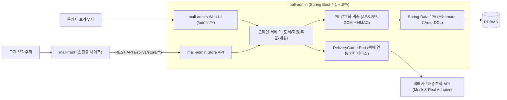

# Book Mall 아키텍처 및 구축 로드맵

## 1. 시스템 토폴로지 개요

`book-mall`은 **관리기 겸 통합 API 서버(`mall-admin`)**와 **고객용 쇼핑몰 사이트(`mall-front`)** 2개 프로젝트로 분리된 구조를 갖는다. 데이터베이스와 암호화 키는 오직 `mall-admin`만 보유하며, `mall-front`는 공개/회원용 REST API(`/api/v1/store/**`)를 호출하여 동작한다.

---

## 2. 프로젝트별 책임 범위

### 2.1 `mall-admin` (관리기 사이트 + 코어 백엔드)
- **도서/카테고리 관리**: 도서 등록(ISBN-13, 저자, 출판사, 정가/판매가, 표지, 설명), 카테고리 계층 관리, 재고 입고/조정, 품절/절판 상태 제어
- **고객 관리 (보안 강화)**: 자체 가입 회원 조회(목록 마스킹), 휴면/차단 상태 관리, 상세 열람 권한 검증 및 열람 감사 로그(`CustomerAccessAuditLog`) 기록
- **주문/배송 관리**: 결제 확인, 출고 지시, 택배사 선택 및 운송장 번호 등록/발급, 배송 상태 추적 동기화, 취소/반품 승인
- **Storefront REST API 제공**: `mall-front`가 소비하는 인증/회원가입, 도서 카탈로그, 장바구니, 주문/결제, 배송조회 API 제공
- **데이터 영속성 및 보안**: JPA 엔티티 기반 DB 자동 생성(`ddl-auto`) 및 고객/수령인 개인정보 자동 암·복호화

### 2.2 `mall-front` (고객용 도서 쇼핑몰 사이트)
- **회원 인증**: 자체 회원가입(아이디/이메일 중복 확인, 약관 동의, 비밀번호 검증), 로그인/로그아웃, 내 정보 수정/탈퇴
- **도서 쇼핑**: 메인 큐레이션(신간/베스트), 카테고리 탐색, 키워드/ISBN 검색, 도서 상세 정보 조회
- **장바구니 및 주문**: 장바구니 담기/수량 변경, 배송지 선택/신규 입력, 주문 생성 및 결제 연동
- **마이페이지 및 배송 조회**: 주문 내역 확인, 운송장 번호 및 단계별 배송 진행 현황 조회, 주문 취소/반품 신청

---

## 3. 단계별 구축 로드맵 (Implementation Phases)

에이전트는 한 번에 모든 코드를 생성하지 않고 아래 단계(Phase) 순서로 검증하며 구축한다.

| 단계 | 목표 | 핵심 산출물 및 완료 조건 |
| :--- | :--- | :--- |
| **Phase 0** | 의사결정 확정 | `docs/adr/000-pending-decisions.md`의 미결 기술 선택지 확정 |
| **Phase 1** | `mall-admin` 기반 & 보안 코어 | Spring Boot 4.1 프로젝트 생성, JPA Auto-DDL 연동, `AesGcmStringConverter` + `HmacBlindIndexer`, 이중 `SecurityFilterChain` 단위 테스트 통과 |
| **Phase 2** | 자체 회원가입 & 고객관리 | 회원 엔티티, Store 회원가입/로그인/내정보 API, 관리기 고객 목록(마스킹)/상세(감사로그) 기능 완성 |
| **Phase 3** | 도서 카탈로그 & 관리기 상품등록 | 카테고리/도서 엔티티, 관리기 도서 등록·수정·재고 관리, Store 도서 목록/검색/상세 API 완성 |
| **Phase 4** | 장바구니 · 주문 · 배송 연동 | 장바구니/주문/배송 엔티티, 재고 동시성 차감, 관리기 운송장 등록 및 `DeliveryCarrierPort`(Mock 어댑터 포함) 배송 상태 전이 완성 |
| **Phase 5** | `mall-front` 구축 & E2E 통합 | 쇼핑몰 프론트 UI(회원가입 → 도서검색 → 장바구니 → 주문 → 배송조회) 및 관리기 API 전 구간 연동 검증 |
