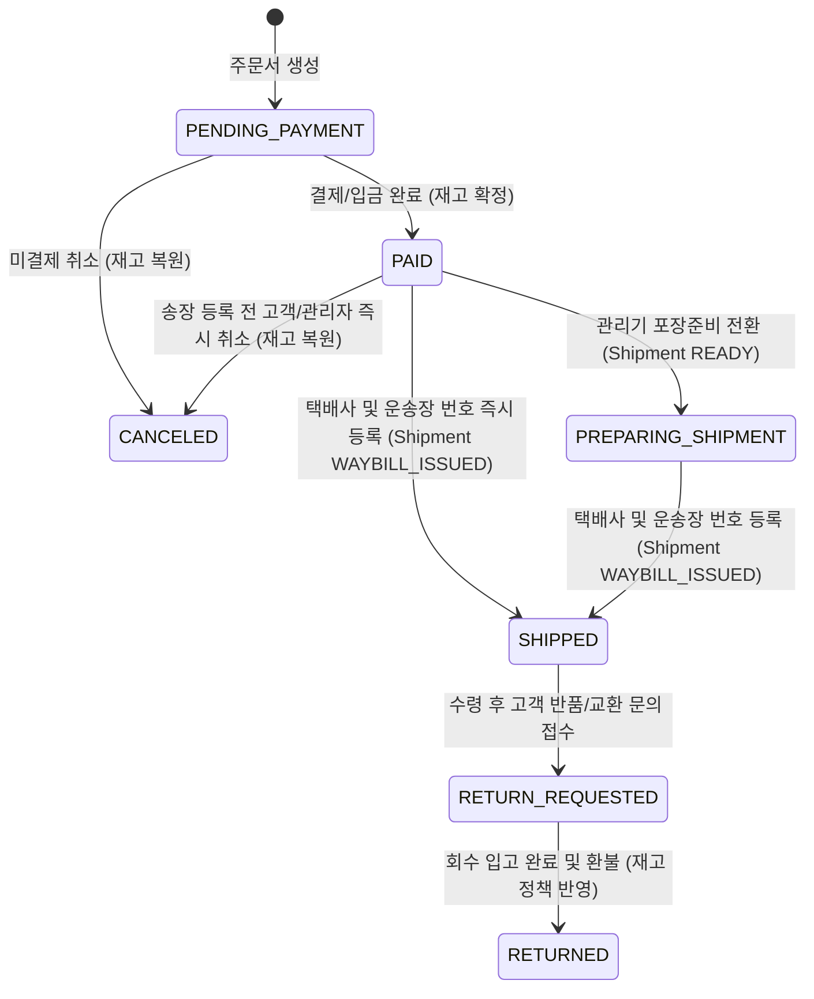

# 주문 · 출고 · 운송장 안내 명세 (`delivery-workflow-spec.md`)

도서 주문 이후 관리기(`mall-admin`)의 출고·운송장 번호 입력과 프론트(`mall-front`)의 **운송장 번호 및 택배사 배송조회 페이지 주소 안내**까지 이어지는 표준 워크플로우 명세다.

> [!IMPORTANT]
> **배송 관리 범위 원칙 (송장번호 입력까지만 시스템 관리)**:
> - 본 시스템(`mall-admin` / `mall-front`)은 외부 택배사 배송추적 중계 API를 연동하여 간선 이동·배달 완료 단계를 자동 수집하지 않는다.
> - 관리기에서 **택배사 선택 + 운송장 번호 입력(`WAYBILL_ISSUED` / 주문 `SHIPPED`)**을 완료하면 시스템 상의 출고 처리는 종료되며, 이후 상세 배송 현황은 고객이 안내받은 **운송장 번호와 택배사 공식 조회 페이지 주소(`trackingUrl`)**를 통해 직접 조회한다.

---

## 1. 주문(`Order`) 및 출고(`Shipment`) 상태머신

주문 상태와 출고/송장 상태를 분리하되, 운송장 번호 등록 시 주문 상태가 `SHIPPED`(송장 등록 · 발송완료)로 일관되게 전이되도록 구성한다.

### 세부 출고(`ShipmentStatus`) 단계
1. `READY`: 발송 대기 / 도서 검수·포장 준비중 (운송장 번호 미등록 상태)
2. `WAYBILL_ISSUED`: 택배사 지정 및 운송장 번호 등록 완료 (이 시점부터 고객의 임의 즉시 주문취소를 차단하며, 고객 화면에 운송장 번호 복사 버튼 및 택배사 조회 URL 노출)

---

## 2. 택배사 코드 및 공식 배송조회 페이지 주소 레지스트리 (`CarrierCode`)

외부 배송추적 API 호출 대신, 각 택배사의 **공식 운송장 조회 웹페이지 주소(`trackingUrl`)**와 고객센터 연락처를 표준 Enum/설정으로 관리하여 프론트엔드(`GET /api/v1/store/orders`, `GET /api/v1/store/carriers`)에 내려준다.

| 코드 (`CarrierCode`) | 택배사명 | 고객 안내용 공식 배송조회 주소 (`trackingUrl`) | 대표 고객센터 |
| :--- | :--- | :--- | :--- |
| `CJ` | CJ대한통운 | `https://trace.cjlogistics.com/next/tracking.html` | `1588-1255` |
| `POST` | 우체국택배 | `https://service.epost.go.kr/iservice/usr/trace/usrtrc001k01.jsp` | `1588-1300` |
| `HANJIN` | 한진택배 | `https://www.hanjin.com/kor/CMS/DeliveryMgr/WaybillSch.do?mCode=MN038` | `1588-0011` |
| `LOTTE` | 롯데택배 | `https://www.lotteglogis.com/home/reservation/tracking/index` | `1588-2121` |
| `LOGEN` | 로젠택배 | `https://www.ilogen.com/web/personal/tkSearch` | `1588-9988` |

### 프론트엔드(`mall-front`) 고객 안내 UI 필수 요건
1. **운송장 등록 완료(`SHIPPED`) 주문 카드**:
   - 발송 택배사명, 운송장 번호, 발송 일시 표시
   - 원클릭 **`운송장 번호 복사`** 버튼 제공
   - 해당 택배사의 **공식 배송조회 URL 텍스트 명시** 및 새 창 이동(`target="_blank" rel="noopener noreferrer"`) 바로가기 버튼 제공
2. **주요 택배사 조회 주소 안내 영역**:
   - 고객의 `주문·배송` 화면에 주요 택배사별 공식 조회 페이지 주소를 상시 안내하여, 고객이 언제든 송장번호로 직접 조회할 수 있도록 지원한다.

---

## 3. 도서 쇼핑몰 배송비 기본 정책 모델

관리기 설정값(또는 정책 상수)으로 제어 가능하도록 설계한다.
- **기본 배송비**: `3,500원` (관리기 설정에서 변경 가능)
- **무료배송 기준 금액**: 도서 실결제 합계 `50,000원` 이상 시 기본 배송비 `0원` (관리기 설정에서 변경 가능)
- **도서/산간 추가 배송비**: 우편번호(`zipCode`) 대역 테이블 기반으로 추가 운임 가산 가능하도록 `ShippingFeeCalculator` 도메인 서비스 분리
