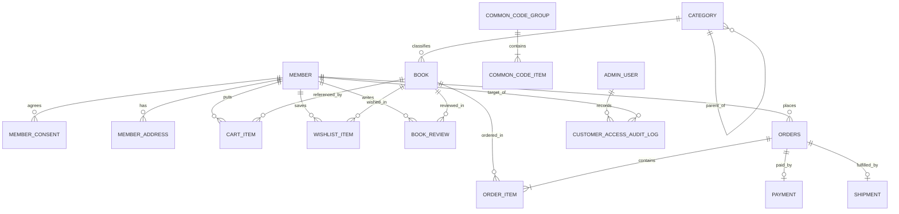

# 도메인 모델 및 JPA 엔티티 명세 (`domain-erd.md`)

`mall-admin`에서 관리하며 Hibernate `ddl-auto`를 통해 DB 테이블로 자동 생성되는 핵심 엔티티 설계 기준이다.

---

## 1. 전체 도메인 관계도 (ERD)

---

## 2. 엔티티별 주요 컬럼 및 암호화/인덱스 정책

### 2.1 회원 도메인 (`member`)

#### `Member` (`members` 테이블)
| 필드명 | 타입 | 제약조건 | 보안 처리 | 설명 |
| :--- | :--- | :--- | :--- | :--- |
| `id` | `Long` | PK, Auto Increment | - | 내부 식별자 |
| `loginId` | `String` | Unique, Not Null, len 50 | 평문(소문자 정규화) 또는 Blind Index | 자체 회원가입 로그인 ID |
| `passwordHash` | `String` | Not Null, len 255 | **단방향 해시 (`Argon2`/`BCrypt`)** | 비밀번호 해시 |
| `name` | `String` | Not Null, len 512 | **`@Convert` AES-256-GCM 암호화** | 회원 실명 |
| `email` | `String` | Not Null, len 512 | **`@Convert` AES-256-GCM 암호화** | 이메일 원문 |
| `emailHash` | `String` | Unique Index, Not Null, len 64 | **`HMAC-SHA256` Blind Index** | 이메일 중복검사·조회용 해시 |
| `phoneNumber` | `String` | Not Null, len 512 | **`@Convert` AES-256-GCM 암호화** | 휴대폰 번호 원문 |
| `phoneHash` | `String` | Index, Not Null, len 64 | **`HMAC-SHA256` Blind Index** | 연락처 검색·중복검사용 해시 |
| `status` | `MemberStatus` | Not Null (`ACTIVE`, `DORMANT`, `BLOCKED`, `WITHDRAWN`) | - | 계정 상태 |
| `failedLoginAttempts` | `int` | Default 0 | - | 연속 로그인 실패 횟수 |
| `lockedUntil` | `LocalDateTime` | Nullable | - | 로그인 잠금 해제 시각 |

#### `MemberAddress` (`member_addresses` 테이블 — 기본/록 배송지)
- `recipientName`, `recipientPhone`, `addressLine1`, `addressLine2`: **전부 `@Convert` AES-256-GCM 암호화**
- `zipCode`: 우편번호(도서산간 배송비 판별을 위해 평문 `len 10` 유지 가능)
- `isDefault`: 기본 배송지 여부 (`boolean`)

#### `MemberConsent` (`member_consents` 테이블)
- 자체 회원가입 시 이용약관(`TERMS_OF_SERVICE`), 개인정보 수집·이용(`PRIVACY_POLICY`), 마케팅 수신(`MARKETING_OPT_IN`) 동의 여부 및 동의 일시 기록

---

### 2.2 도서 상품 도메인 (`catalog`)

#### `Category` (`categories` 테이블)
- `id`, `parent` (`@ManyToOne(LAZY)` 자기참조 계층), `name`, `displayOrder`, `active`

#### `Book` (`books` 테이블)
| 필드명 | 타입 | 제약조건 | 설명 |
| :--- | :--- | :--- | :--- |
| `id` | `Long` | PK | 도서 식별자 |
| `isbn13` | `String` | Unique Index, Not Null, len 13 | 국제표준도서번호 (하이픈 제거 13자리) |
| `categoryCode` | `String` | Index, Not Null, len 40 | 도서 분야 코드 (`BOOK_CATEGORY` 공통코드 참조) |
| `bookTypeCode` | `String` | Index, Not Null, len 40 | 단권 / 세트 구분 코드 (`BOOK_TYPE` 공통코드 참조: `SINGLE`, `SET`, `LECTURE_SET` 등) |
| `title` | `String` | Index, Not Null, len 300 | 도서명 |
| `subtitle` | `String` | Nullable, len 300 | 부제 |
| `author` | `String` | Index, Not Null, len 200 | 저자 (복수 저자 표기 포함) |
| `translator` | `String` | Nullable, len 200 | 역자 |
| `publisher` | `String` | Not Null, len 150 | 출판사 |
| `publishedDate` | `LocalDate` | Index, Not Null | 출간일 (신간도서 정렬 기준) |
| `pageCount` | `Integer` | Nullable (`> 0`) | 쪽수 (YES24/알라딘 품목정보 표기용) |
| `dimensions` | `String` | Nullable, len 100 | 크기/판형 (예: `152*225mm (신국판)`) |
| `listPrice` | `Long` | Not Null (`>= 0`) | 정가 (원화 정수) |
| `discountRate` | `int` | Not Null (`0 ~ 10`) | 도서정가제 할인율 (최대 10% 검증) |
| `salePrice` | `Long` | Not Null (`>= 0`) | 판매가 |
| `rewardRate` | `int` | Default 5 (`0 ~ 5`) | 기본 적립률 안내용 (`%`) |
| `stockQuantity` | `int` | Not Null (`>= 0`) | 현재 가용 재고 수량 |
| `salesCount` | `long` | Index, Default 0 | 누적 판매수량 (베스트셀러 랭킹 산출 기준) |
| `ratingAvg` | `BigDecimal(3,2)` | Default `0.00` | 독자 평점 평균 (`0.00 ~ 5.00`) |
| `reviewCount` | `int` | Default 0 | 활성 리뷰/한줄평 수 |
| `mdPick` | `boolean` | Index, Default `false` | MD 추천(오늘의 책/화제의 책) 지정 여부 |
| `saleStatus` | `BookSaleStatus` | `ON_SALE`, `PREORDER`, `OUT_OF_STOCK`, `DISCONTINUED`, `HIDDEN` | 판매 상태 |
| `coverImageUrl` | `String` | Nullable, len 500 | 표지 이미지 경로/URL |
| `description` | `String` (`TEXT`) | Nullable | 책 소개 |
| `tableOfContents` | `String` (`TEXT`) | Nullable | 목차 (상세페이지 별도 탭 노출) |
| `authorBio` | `String` (`TEXT`) | Nullable | 저자 및 역자 소개 |
| `publisherReview` | `String` (`TEXT`) | Nullable | 출판사 서평 |
| `version` | `Long` | `@Version` | 재고 동시성 제어용 낙관적 락 버전 |

#### `BookReview` (`book_reviews` 테이블 — 독자 별점 & 한줄평/리뷰)
- `member` (`@ManyToOne(LAZY)`), `book` (`@ManyToOne(LAZY)`)
- `rating` (`1 ~ 5`), `content` (`len 2000`), `verifiedPurchase` (`boolean` — 실구매자 배지 표시용), `visible` (`boolean` — 관리기 블라인드 제어용)
- 작성자 표시는 실명 원문 대신 마스킹된 아이디(예: `book****`)로만 공개 API에 노출한다.

#### `CurationBanner` (`curation_banners` 테이블 — 메인 배너/큐레이션)
- `title`, `subtitle`, `targetBook` (`@ManyToOne(LAZY)`, Nullable), `linkUrl`, `imageUrl`, `displayOrder`, `active`

---

### 2.3 장바구니 · 주문 · 배송 도메인 (`order` & `delivery`)

#### `CartItem` (`cart_items` 테이블)
- `(member_id, book_id)` 복합 Unique 제약조건, `quantity` (`>= 1`)

#### `WishlistItem` (`wishlist_items` 테이블 — YES24/알라딘 보관함·찜)
- `(member_id, book_id)` 복합 Unique 제약조건, `createdAt` (보관함에서 선택 도서 장바구니 일괄 이동 지원)

#### `Order` (`orders` 테이블)
- `orderNo`: 외부 노출용 주문번호 (예: `ORD-20261112-XXXX`, Unique Index — PK 노출 방지)
- `member`: `@ManyToOne(LAZY)`
- `orderStatus`: `PENDING_PAYMENT`, `PAID`, `PREPARING_SHIPMENT`, `SHIPPED`, `CANCELED`, `RETURN_REQUESTED`, `RETURNED` (송장번호 등록 시 `SHIPPED`로 출고 관리 종료)
- 금액 스냅샷: `totalBookAmount`, `shippingFee`, `discountAmount`, `finalPayAmount`

#### `OrderItem` (`order_items` 테이블)
- 주문 시점의 도서명(`bookTitleSnapshot`), 단가(`salePriceSnapshot`), 수량(`quantity`), 합계 금액을 스냅샷으로 보존 (이후 도서 가격이 바뀌어도 과거 주문 내역 불변 보장)

#### `Shipment` (`shipments` 테이블 — 출고 · 운송장 번호 관리 핵심)
- `order`: `@OneToOne(LAZY)`
- 수령인 스냅샷 (암호화 필수):
  - `recipientName` (**AES-256-GCM 암호화**)
  - `recipientPhone` (**AES-256-GCM 암호화**)
  - `zipCode` (평문 — 권역별 배송비/집배코드용)
  - `addressLine1`, `addressLine2` (**AES-256-GCM 암호화**)
  - `deliveryMemo` (배송 요청사항, 길이 제한)
- 택배 운송장 안내 정보 (송장번호 입력까지만 관리, 이후 배송 추적은 고객이 택배사 페이지에서 직접 조회):
  - `carrierCode` (예: `CJ`, `POST`, `HANJIN`, `LOTTE`, `LOGEN` — 코드별 택배사 공식 조회 URL 매핑)
  - `trackingNumber` (운송장 번호, Index)
  - `shipmentStatus` (`READY`, `WAYBILL_ISSUED`, `RETURNED`)
  - `shippedAt`

---

### 2.4 관리자 및 보안 감사 도메인 (`admin`)

#### `AdminUser` (`admin_users` 테이블)
- 일반 쇼핑몰 회원(`Member`) 테이블과 **물리적으로 분리**하여 권한 상승(Privilege Escalation) 가능성을 원천 차단한다.
- `adminLoginId`, `passwordHash`, `name`, `role` (`SUPER_ADMIN`, `MD_MANAGER`, `CS_MANAGER`, `LOGISTICS_MANAGER`), `active`

#### `CustomerAccessAuditLog` (`customer_access_audit_logs` 테이블)
- 관리자가 특정 고객의 암호화된 원문 개인정보를 단건 상세 조회하거나 상태를 변경할 때 `adminUserId`, `targetMemberId`, `actionType` (`VIEW_DETAIL`, `UPDATE_STATUS`), `reason`, `clientIp`, `createdAt`을 불변 로그로 기록한다.

#### `CommonCodeGroup` & `CommonCodeItem` (`common_code_groups`, `common_code_items` 테이블 — 분류·선택항목 통합 코드 관리)
- 하드코딩된 드롭다운 없이 관리기에서 도서 분야(`BOOK_CATEGORY`), 단권/세트 구분(`BOOK_TYPE`), 도서 판매 상태(`BOOK_SALE_STATUS`), 회원 구분/등급(`MEMBER_GRADE`), 문의·게시판 분류(`BOARD_CATEGORY`), 택배사 및 공식 조회 주소(`CARRIER_CODE`)를 통합 관리한다.
- `CommonCodeGroup`: `groupCode` (PK/Unique, len 50), `groupName`, `summary`, `sortOrder`, `active`
- `CommonCodeItem`: `id` (PK), `group` (`@ManyToOne(LAZY)`), `code` (`(group_id, code)` 복합 Unique), `name` (화면 표시 이름), `sortOrder` (선택창 노출 순서), `active` (사용/숨김 여부), `extraJson` (`hanja`, `trackingUrl`, `csPhone` 등 확장 속성), `description`
